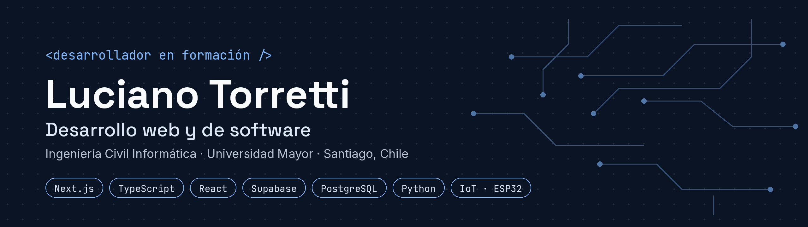

  

  <a href="mailto:lucianotp000@gmail.com"> lucianotp000@gmail.com</a>
  &nbsp;&nbsp;&nbsp;
  <a href="https://www.linkedin.com/in/lucianotorretti/"> lucianotorretti</a>
  &nbsp;&nbsp;&nbsp;
  <a href="https://www.instagram.com/luciano_tp_?cplk=dGl2ejg2NDlyaWJy"> luciano_tp_</a>

  

## Sobre mí

Estudiante de Ingeniería Civil Informática en la Universidad Mayor, enfocado en el desarrollo de software y aplicaciones web. Lo que me motiva es simple: construir herramientas que le ahorren tiempo a las personas, automatizando tareas repetitivas para que el trabajo rinda más.

Me gusta llevar una idea completa desde el problema hasta el producto funcionando.

Mi forma de trabajar parte antes del código: levanto requerimientos, defino la arquitectura y considero la seguridad y el cumplimiento normativo desde el primer día. Desarrollo de forma iterativa con agentes de IA como Claude Code, tratándolos como un equipo al que dirijo, y valido cada etapa con tests.

Fuera de la pantalla, diseño tatuajes originales. Es la misma búsqueda que aplico en mis proyectos: crear algo propio en lugar de repetir lo que ya existe.

- **Ahora:** construyendo AforoON, la plataforma de reservas y control de acceso del Hub Providencia.
- **Aprendiendo:** ingeniería de IA y agentes, testing y CI/CD.
- **Buscando:** mi primera práctica profesional en desarrollo de software o web.

## Tecnologías

  

También: Playwright · NumPy · OPC UA · ESP32 · desarrollo asistido por IA con Claude Code

## Proyectos destacados

<table>
  <tr>
    <td width="50%" valign="top">
      <h3><a href="https://github.com/LucianoTorretti/AforoOn">AforoON</a></h3>
      
Credencial digital, reservas y control de aforo para el Hub Providencia. Registro con validación de RUT, reservas con reglas de aforo, acceso con QR dinámico o NFC mediante un lector ESP32, y dashboard de administración.

      
<code>Next.js</code> <code>TypeScript</code> <code>Supabase</code> <code>Playwright</code> <code>ESP32</code>

      
<a href="https://aforo-on.vercel.app">Ver demo</a> · <a href="https://github.com/LucianoTorretti/AforoOn">Código</a>

    </td>
    <td width="50%" valign="top">
      <h3><a href="https://github.com/LucianoTorretti/paper_tensile_predictor">Predictor de resistencia del papel</a></h3>
      
Red neuronal implementada desde cero en NumPy que estima en tiempo real la resistencia a la tracción del papel Kraft a partir de cuatro variables de proceso. Integración industrial con OPC UA, validación de seguridad y 69 tests.

      
<code>Python</code> <code>NumPy</code> <code>OPC UA</code> <code>pytest</code>

      
<a href="https://github.com/LucianoTorretti/paper_tensile_predictor">Código</a>

    </td>
  </tr>
</table>

## Contacto

Si tienes una práctica, un proyecto o una idea en la que pueda aportar, escríbeme por [LinkedIn](https://www.linkedin.com/in/lucianotorretti/) o a [lucianotp000@gmail.com](mailto:lucianotp000@gmail.com).
